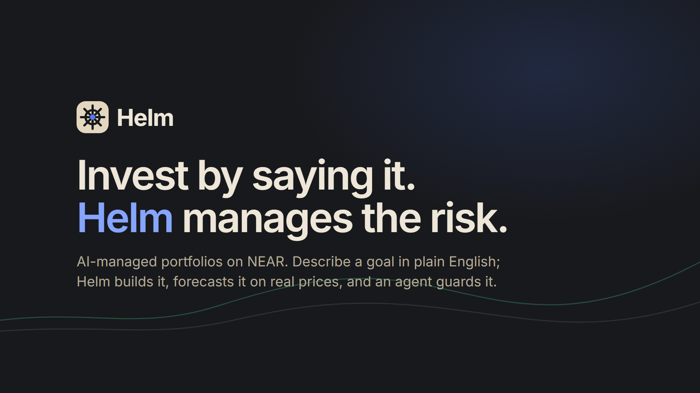
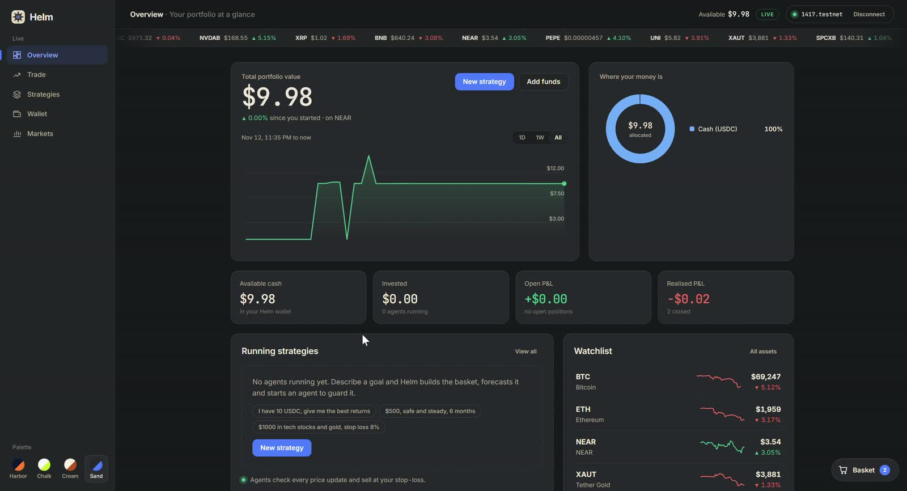
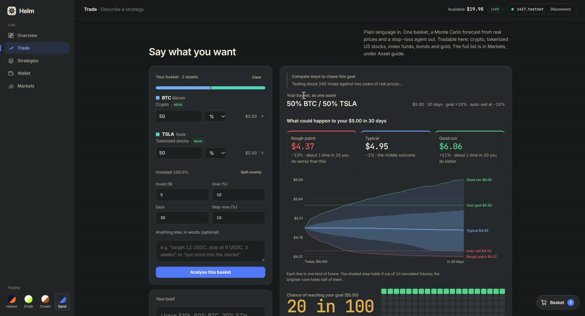
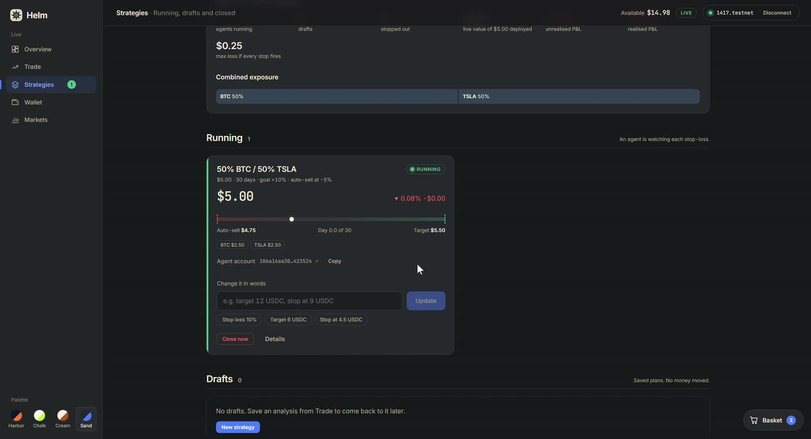
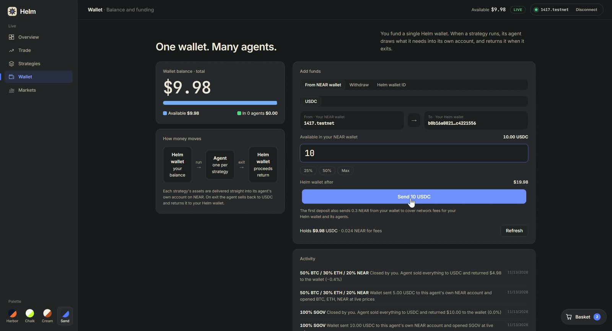
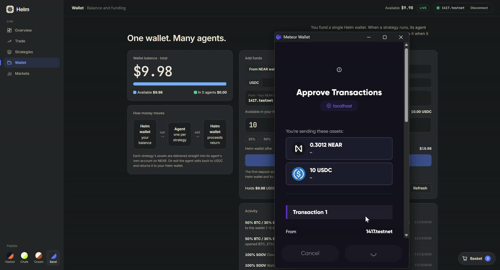
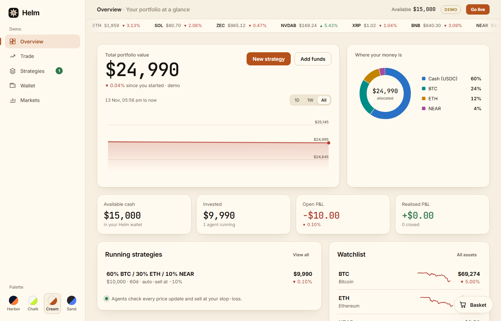
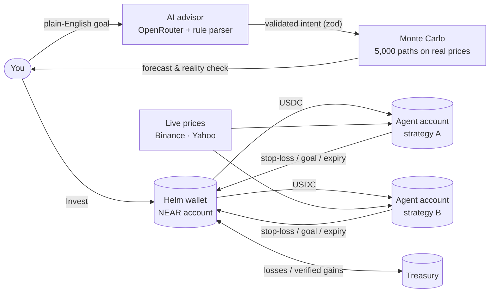

<div align="center">


# Helm

**Invest by saying it. Helm manages the risk.**

AI-managed portfolios on NEAR: describe a goal in plain English, see what could happen to your money before you commit,<br/>and let a dedicated stop-loss agent guard every strategy around the clock.

[](https://nextjs.org)
[](https://react.dev)
[](https://www.typescriptlang.org)
[](https://near.org)
[](lib/helm.test.ts)
[](LICENSE)

[Overview](#overview) · [Problem](#the-problem) · [Solution](#the-solution) · [Features](#features) · [How it works](#how-it-works) · [Quick start](#quick-start) · [Limits](#honest-limits)

<br/>



</div>

---

## Overview

Helm is a portfolio app for people who know **what** they want from their money but not **how** to build it. You type something like:

> *"I have $10k. 60% BTC, 30% ETH, 10% NEAR. I want 10% in 2 months with a 10% stop loss."*

or simply *"I have 10 USDC, give me the best returns"*, and Helm:

1. **Builds** one basket from crypto, tokenized US stocks, index funds, bonds and gold.
2. **Forecasts** it with 5,000 Monte Carlo futures replayed from two years of real daily prices, so you see a rough patch, a typical outcome and a good run *before* any money moves.
3. **Executes** it on NEAR, giving the strategy its **own agent account** that sells on your stop-loss, takes profit at your goal, and returns the money to your wallet.

Built for the **NEAR Hackathon** 

## The problem

- **Building a diversified portfolio is expert work.** Picking weights, sizing positions and setting exits needs knowledge most people don't have.
- **Risk is invisible until it hurts.** Apps show past returns and a price chart, not the range of outcomes your plan can actually produce.
- **Stop-losses need someone watching.** On-chain, there is no broker to enforce one; if you're away when the price falls, nothing sells.
- **One wallet, many plans, one mess.** Running several strategies from one account mixes their balances, so you can't stop one without touching the others.

## The solution

| | What Helm does |
|---|---|
| 🗣️ **Plain language in** | An AI advisor turns a sentence into a structured, validated plan (assets, weights, amount, goal, horizon, stop-loss). Vague requests get a recommended mix with a written rationale. |
| 📈 **Honest forecasts** | A Monte Carlo engine replays real market days (correlations and fat tails preserved) and states plainly when a goal is a stretch, e.g. *"20 in 100 futures reach this goal"*. |
| 🤖 **One agent per strategy** | Each executed strategy gets its own NEAR account and stop-loss agent, so strategies never share balances and each can be closed independently. |
| 👛 **One wallet for everything** | A single Helm wallet, derived from your NEAR account, funds every agent and receives every exit. Same account, same wallet, on any device. |

## Features

### Investing
- **Natural-language strategies**: write a goal, or just an amount and a risk appetite; edit later in words (*"stop loss 5%"*, *"target 12 USDC"*, *"move the NEAR part into gold"*).
- **Basket builder**: add assets from Markets, set each share as % or $, then analyse without an AI call.
- **Compare mixes**: about 240 candidate mixes are tested to show a safer, a balanced and a goal-focused alternative for the same goal.
- **18 tradable assets**: BTC, ETH, NEAR, tokenized gold, 7 tokenized US stocks (Apple, Microsoft, Nvidia, Tesla, Alphabet, Amazon, Meta), S&P 500 and Nasdaq-100 funds, Treasuries, T-bills, gold and silver ETFs.

### Risk and analysis
- **Fan-chart forecast** with goal and auto-sell lines, outcome cards, chance-of-goal waffle and a "what each goal would cost" ladder.
- **Reality check** in plain language, plus pro metrics: VaR, CVaR, expected shortfall, per-asset volatility, Sharpe, drawdown and correlations.
- **Calibration you can verify**: a backtest over 435 historical start dates (see [accuracy](#how-accurate-is-the-forecast)).

### Agents and settlement
- **Stop-loss, take-profit and expiry** rules checked on every price update; a missing price never triggers a stop.
- **Every movement is a NEAR transaction** linked to NearBlocks, signed in the browser and tested byte-for-byte against near-js.
- **Treasury-backed exits**: losses settle to a treasury in the exit transaction; gains are paid only after the server verifies the agent's exit on-chain.
- **Real progress, not spinners**: execution shows its actual steps (checking the wallet, creating the agent account, sending USDC); results arrive as toasts with Undo where it makes sense.

### Experience
- **Overview dashboard**: explorable value chart (1D / 1W / All with crosshair), allocation ring, P&L, running strategies, live watchlist and market movers.
- **Markets**: top-100 live markets with sparklines and detail charts, plus an asset guide of everything the agents can trade.
- **Clear money flows**: every transfer shows from → to, quick 25 / 50 / Max amounts, and your balance after the transfer.
- **Four palettes**: Harbor, Chalk, Cream and Sand, each a fixed look; keyboard shortcuts `1`–`5`, bottom tab bar on phones, reduced-motion support.
- **Demo and Live**: try everything instantly with a simulated $25k wallet, or connect Meteor and trade for real on NEAR testnet.

## Screenshots

<table>
  <tr>
    <td width="50%"><br/><sub><b>Overview</b>: value history, allocation, P&amp;L and live watchlist</sub></td>
    <td width="50%"><br/><sub><b>Trade</b>: a basket analysed with 5,000 simulated futures</sub></td>
  </tr>
  <tr>
    <td><br/><sub><b>Strategies</b>: a running agent between its auto-sell and its target</sub></td>
    <td><br/><sub><b>Wallet</b>: from → to, quick amounts, balance after the transfer</sub></td>
  </tr>
  <tr>
    <td><br/><sub><b>Funding</b>: one approval in Meteor, settled on NEAR</sub></td>
    <td><br/><sub><b>Palettes</b>: the Cream look of the same dashboard</sub></td>
  </tr>
</table>

## How it works



**1. Understanding the request.** `/api/parse` asks a chain of free OpenRouter models for a JSON plan, validated with zod. If every model fails or hits its quota, a deterministic parser takes over (it understands percentages, named assets, money targets such as "target 12 USDC", and risk words). The UI always says which one ran. The AI never produces numbers about the future.

**2. Forecasting** (`lib/montecarlo.ts`). Historical bootstrap over 729 days of real daily prices: each simulated day replays one whole observed day across all assets, preserving correlation and fat tails. The past average trend is removed by default (drift-neutral) so a bull or bear run isn't projected forward. Seeded and reproducible; the stop-loss in the model is the same rule the agent uses.

**3. Running** (`lib/agent.ts`, `lib/executor.ts`). On every price update each active strategy is marked to market and checked against its stop-loss, goal and horizon. Exits that fail or fill partially retry on the next tick.

**4. Settling on NEAR.**

| Step | What happens on-chain |
|---|---|
| Unlock | Your NEAR wallet signs one fixed message; the SHA-256 of that deterministic Ed25519 signature becomes your **Helm wallet** key. Nothing is stored on a server. |
| Deposit | Meteor sends Circle testnet USDC to the Helm wallet, plus 0.3 NEAR the first time for network fees. |
| Invest | The Helm wallet creates the strategy's **agent account**, registers it with the token and transfers the USDC. Positions open at live market prices. |
| Exit | The agent signs its own transfer back to the Helm wallet. A loss goes to the treasury in the same transaction; a gain is paid by the treasury via `/api/settle` after the server verifies the exit (right signer, amount and wallet, at most +25%). |
| Withdraw | The Helm wallet sends USDC back to your NEAR wallet. |

### Built on Tidepool (NEAR Intents)

Helm is built on **[Tidepool](https://www.usetidepool.tech/llms-full.txt)**, a 1Click-compatible sandbox of NEAR Intents. Its token list, quotes, signed intents (`raw_ed25519`), multi-network deposit addresses and tokenized-stock prices are integrated in `lib/tidepool.ts` and verified against the live API. In Tidepool mode, swaps deliver each asset straight into the strategy's agent account, and the agent signs its own exit with no wallet popup.

During testing the Tidepool faucet did not deliver test tokens, so to run strategies end to end with funds we actually held, live mode defaults to **Helm settlement** on Circle's testnet USDC (described above). Switch with `NEXT_PUBLIC_SETTLEMENT=tidepool`.

### How accurate is the forecast?

`npm run backtest` replays the model at **435 past start dates** across 5 portfolios (crypto, 60/40, tech stocks, diversified) and 30 / 60-day horizons, using only data available at each date.

| Measure | Target | Result |
|---|---:|---:|
| Real outcome inside the 90% range | 90% | **94%** |
| Real outcome inside the 50% range | 50% | **59%** |
| Real outcome below the 5th percentile | 5% | **4%** |

The ranges are slightly cautious, which is the safer direction. Drift-neutral was better calibrated than keeping the historical trend. Results live in `data/backtest.json` and are shown in-app under *"How reliable is this forecast?"*. It is a map of how wide outcomes can be, not a prediction.

## Tech stack

| Layer | Tools |
|---|---|
| App | Next.js 15 (App Router), React 19, TypeScript (strict) |
| Chain | NEAR testnet, `@near-js/transactions`, near-wallet-selector (Meteor), WebCrypto Ed25519 |
| Settlement | Circle testnet USDC (NEP-141), Tidepool / NEAR Intents (1Click) |
| AI | OpenRouter free models with key rotation, zod-validated output, deterministic fallback parser |
| Data | Binance (crypto, gold), Yahoo Finance (stocks, funds), 729-day snapshot for the demo |
| Quality | Vitest (36 tests), backtest script, self-hosted Inter and JetBrains Mono |

## Quick start

**Prerequisites:** Node.js 22.18+ (the scripts import TypeScript directly) and, for live mode, the [Meteor wallet](https://meteorwallet.app) on NEAR testnet.

```bash
npm install
cp .env.example .env.local     # optional: add OpenRouter keys; the rule parser works without them
npm run dev                    # http://localhost:3000
```

Open **`/demo`** for the instant simulated version or **`/live`** to connect Meteor.

### Environment variables

| Variable | Required | Description |
|---|---|---|
| `OPENROUTER_API_KEYS` | No | One or more keys, comma separated. Rotated automatically when one hits the free daily limit. |
| `OPENROUTER_MODELS` | No | Override the model chain (comma separated). |
| `NEXT_PUBLIC_WALLET_NETWORK` | No | `testnet` (default) or `mainnet`. |
| `NEXT_PUBLIC_SETTLEMENT` | No | `helm` (default, Circle testnet USDC) or `tidepool`. |
| `HELM_TREASURY_SEED` | Live gains | 64 hex characters, **server-only**. Treasury key that pays verified gains. Fund it at `/treasury`. |

### Scripts

| Command | Description |
|---|---|
| `npm run dev` | Start the development server |
| `npm run build` / `npm start` | Production build and server |
| `npm test` | Parser, edits, Monte Carlo, agents, multi-strategy, key derivation, signing and gain-claim checks |
| `npm run backtest` | Re-run the forecast calibration backtest |
| `npm run snapshot` | Refresh `data/snapshot.json` with real price history |
| `node scripts/tp-probe.mjs` | Probe the live Tidepool API with a fresh key |

## Project structure

```
helm/
├── app/
│   ├── page.tsx            # landing page
│   ├── demo/ · live/       # the two workspaces
│   ├── treasury/           # operator page to fund the treasury
│   └── api/                # parse · prices · markets · chart · market · settle · treasury
├── components/             # Workspace shell, Overview, Trade, Strategies, Wallet, Markets, charts, UI kit
├── lib/
│   ├── montecarlo.ts       # forecasting engine
│   ├── agent.ts            # stop-loss / take-profit / expiry rules
│   ├── executor.ts         # simulated, Tidepool and Helm settlement
│   ├── near.ts             # RPC, signing, transfers, nonce handling
│   ├── agentKey.ts         # deterministic Helm wallet and agent keys
│   ├── gainClaim.ts        # on-chain verification of treasury payouts
│   ├── tidepool.ts         # NEAR Intents (1Click) client
│   └── parse.ts · advisor.ts · types.ts · universe.ts
├── data/                   # price snapshot and backtest results
├── scripts/                # snapshot, backtest, Tidepool probe
└── docs/                   # logo, banner, screenshots
```

## Honest limits

- **Agents run in the browser tab.** Testnet keys for the Helm wallet and agents live in `localStorage`; close the tab and nothing is watching. Production needs a server worker, TEE or on-chain agent with proper key custody.
- **Fills are simulated at live prices** in Helm settlement, because NEAR testnet has no DEX for these assets. Tidepool mode uses real sandbox swaps.
- **A forecast is not a promise.** It assumes the last two years resemble the future and cannot foresee news or crashes worse than the sample.
- **Testnet only.** Test tokens have no value. NEAR Intents has no testnet, which is why Tidepool is used; moving to mainnet 1Click is a change inside `lib/tidepool.ts`.
- **Free AI quotas** are about 50 requests per key per day; Helm rotates keys and falls back to the rule parser, and says so in the UI.

## Roadmap

- [ ] Server-side or TEE-hosted agents so strategies keep running with the tab closed
- [ ] Mainnet settlement through NEAR Intents 1Click
- [ ] Real on-chain swaps for tokenized assets as liquidity arrives on NEAR
- [ ] Rebalancing and trailing stop-losses
- [ ] Notifications when a stop-loss or goal fires

## Acknowledgements

- [NEAR Protocol](https://near.org) and [NEAR Intents](https://docs.near-intents.org)
- [Tidepool](https://www.usetidepool.tech), the NEAR Intents sandbox Helm is built on
- [Meteor Wallet](https://meteorwallet.app) · [OpenRouter](https://openrouter.ai) · Binance and Yahoo Finance market data


## License

[MIT](LICENSE) © 2026 Helm contributors

<sub>Helm runs on testnet with test tokens. Forecasts are Monte Carlo simulations on real prices, not promises. Not financial advice.</sub>
